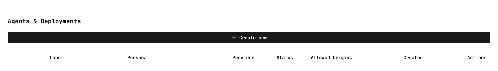
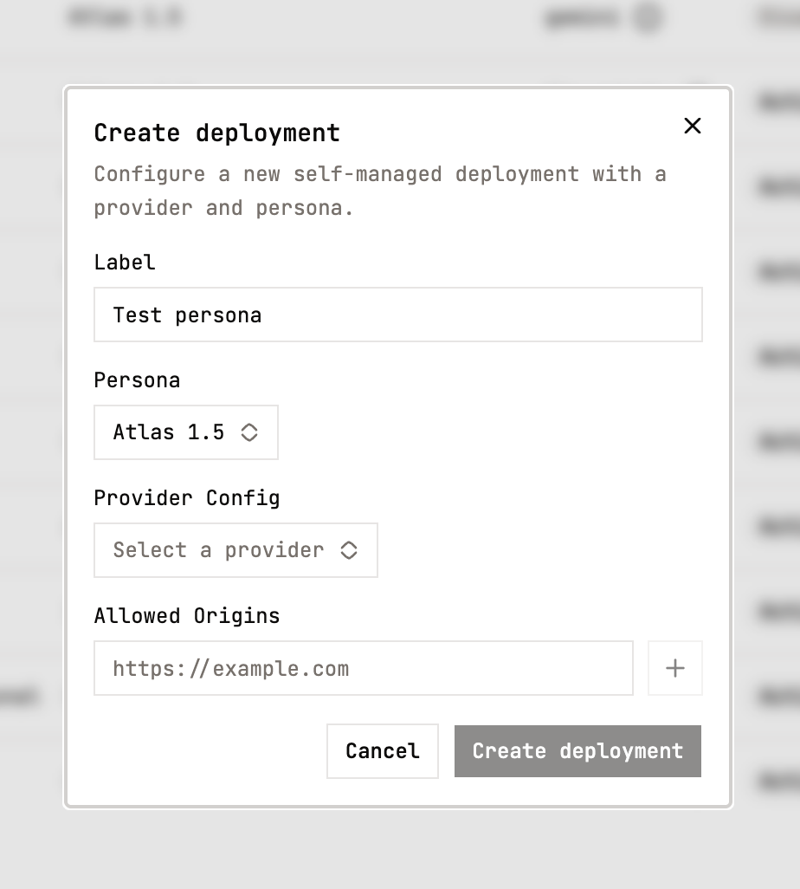
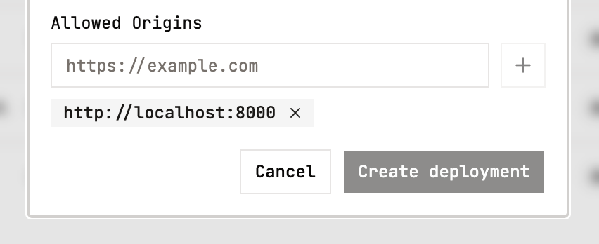

<Steps>
  <Step title="Create a new hosted deployment in the Keyframe platform" stepNumber={1}>
    Navigate to the [agents & deployments page](https://platform.keyframelabs.com/agents-and-deployments), and click `Create new`.

    

    Select an avatar and the appropriate provider,  adding the provider credentials highlighted in the prerequisites.

    

    Add to `Allowed Origins` the client URLs you'd like to authorize for your agent.

    

    Click `Create deployment`, and copy the generated agent ID (`agent_...`).
  </Step>
  <Step title="Create the HTML" stepNumber={2}>
    ```html expandable
    <!DOCTYPE html>
    <html lang="en">
      <head>
        <meta charset="UTF-8" />
        <meta name="viewport" content="width=device-width, initial-scale=1.0" />
        <title>My Keyframe Avatar Demo</title>
      </head>
      <body>
        <div
          style="
            font-family: monospace;
            display: flex;
            flex-direction: column;
            justify-content: center;
            align-items: center;
            gap: 15px;
            text-align: center;
            padding: 25px;
          "
        >
          <h1>Chat with your Keyframe Avatar</h1>
    
          <div
            id="avatar-video"
            style="
              width: 95%;
              max-width: 384px;
              aspect-ratio: 1 / 1;
              background: black;
            "
          ></div>
    
          <div style="display: flex; gap: 5px;">
            <button id="start">Start</button>
            <button id="stop" disabled>Stop</button>
          </div>
        </div>
      </body>
    
      <script type="module">
        import { PersonaEmbed } from 'https://esm.sh/@keyframelabs/elements@latest';
    
        const agentId = 'agent_...';
    	
        const embed = new PersonaEmbed({
      	  container: document.getElementById('avatar-video'),
      	  agentId: agentId,
      	  videoFit: 'contain',
      	  onStateChange: (status) => console.log('Status:', status),
          onAgentStateChange: (state) => console.log('Agent:', state),
          onDisconnect: () => console.log('Disconnected'),
          onError: (err) => console.error(err),
        });
    
        const startBtn = document.getElementById('start');
        const stopBtn = document.getElementById('stop');
    
        startBtn.addEventListener('click', async () => {
          try {
            startBtn.disabled = true;
            await embed.connect();
            stopBtn.disabled = false;
          } catch (err) {
            console.error('Connect failed:', err);
            startBtn.disabled = false;
          }
        });
    
        stopBtn.addEventListener('click', async () => {
          try {
            await embed.disconnect();
          } finally {
            stopBtn.disabled = true;
            startBtn.disabled = false;
          }
        });
      </script>
    </html>
    ```
  </Step>
  <Step title="Replace placeholder provider credentials" stepNumber={3}>
    In the HTML, replace `agentId` with the one generated in step 1.

    ```html
    // Replace with the agent ID from step 1
    const agentId = 'agent_...';
    ```

    <Note>
      Agents created before agent IDs can still pass `publishableKey: 'kfl_pk_live_...'` instead. For a `private` agent, mint a conversation token on your server with `POST /v1/agents/{agent_id}/token` and pass `conversationToken` instead of `agentId`.
    </Note>
  </Step>
  <Step title="Start a local server" stepNumber={4}>
    <Tabs>
      <Tab title="node">
        ```shellscript
        npx http-server -p 8000
        ```
      </Tab>
      <Tab title="python">
        ```shellscript
        python -m http.server 8000
        ```
      </Tab>
    </Tabs>
  </Step>
  <Step title="Open and test" stepNumber={5}>
    1. Navigate to `http://localhost:8000` in your browser
    2. Allow microphone access when prompted
    3. Your avatar will appear automatically and you can start talking
    4. When you’re done, close the browser tab to end the session
  </Step>
</Steps>

## Summary

Congratulations on your first video call with a Keyframe avatar. A couple things worth highlighting:

- Your Keyframe agent ID authenticates your client application with both your agent or LLM and Keyframe
- The Keyframe Elements SDK establishes all necessary real-time audio/video connections to display and interact with your avatar